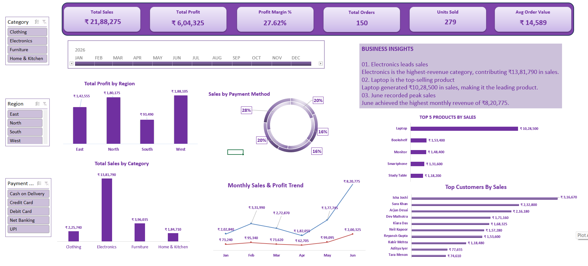

# E-commerce Sales & Profitability Analysis Dashboard

## Project Overview
An interactive E-commerce Sales Dashboard developed using Microsoft Excel to analyse sales performance, profitability, product performance and customer behaviour.

## Tools Used
- Microsoft Excel
- PivotTables
- PivotCharts
- Slicers and Timeline

## Key Performance Indicators (KPIs)
- Total Sales
- Total Profit
- Profit Margin
- Total Orders
- Units Sold
- Average Order Value

## Analysis Performed
- Monthly Sales and Profit Trends
- Sales by Category
- Profit by Region
- Top 5 Products by Sales
- Sales by Payment Method
- Top Customers

## Key Features
- Interactive dashboard
- Dynamic filtering using slicers and timeline
- Business insights to support decision-making

## Project File
The completed Excel dashboard is available in this repository.

## Dashboard Preview

